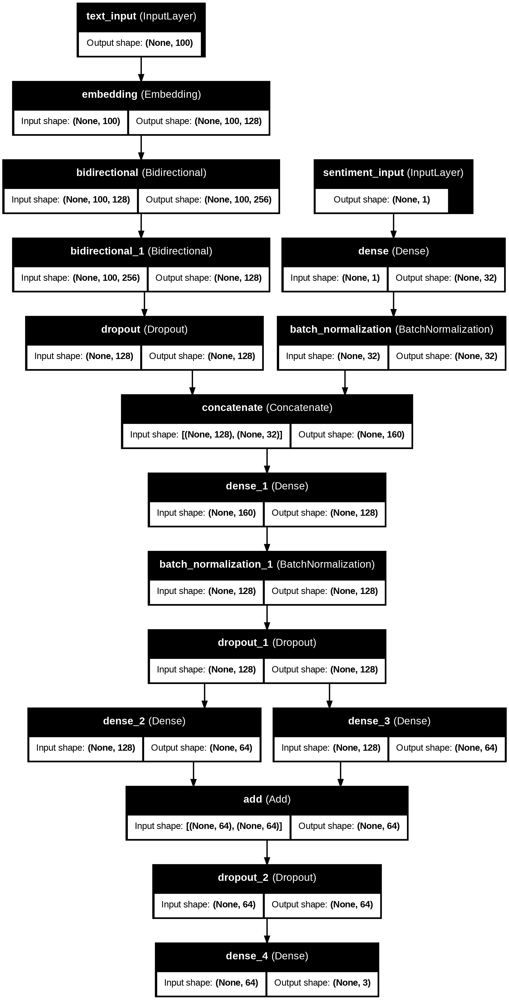

# Emotion Classification from Tweets: Dual-Input BiLSTM with Sentiment Embedding

Classifies the emotion of a tweet as **angry**, **disappointed** or **happy** by combining word embeddings with a sentiment polarity score in a dual-input bidirectional LSTM (BiLSTM). Built with TensorFlow/Keras and served as a Gradio web app.

**Live demo:** [Hugging Face Space](https://huggingface.co/spaces/bhuvann13/Twitter_emotional_analysis)

## Data

[Cleaned emotion extraction dataset from Twitter](https://www.kaggle.com/datasets/kosweet/cleaned-emotion-extraction-dataset-from-twitter) (Kaggle): 916,575 tweets, roughly balanced across the three classes.

| Emotion | Tweets |
|---|---|
| disappointed | 313,714 |
| happy | 301,871 |
| angry | 300,990 |

## Model

- **Input 1:** the tokenised tweet (sequence length 100) → embedding → BiLSTM.
- **Input 2:** a sentiment polarity score for the same tweet.
- The two branches are concatenated and passed through residual dense layers to a softmax over the three emotions.
- Trained with early stopping, model checkpointing and learning-rate reduction on a validation split.



## Results (held-out test set, 91,658 tweets)

**Test accuracy 90.67%**, test loss 0.2151.

| Emotion | Precision | Recall | F1 |
|---|---|---|---|
| angry | 0.83 | 0.93 | 0.88 |
| disappointed | 0.91 | 0.86 | 0.88 |
| happy | 1.00 | 0.93 | 0.96 |
| **macro average** | **0.91** | **0.91** | **0.91** |

Most errors are between *angry* and *disappointed*, which share negative sentiment; *happy* is almost never confused with the others.

| Confusion matrix | ROC curves |
|---|---|
| .png) | .png) |

## Run it

```bash
git clone https://github.com/bhuvannv13/Twitter-Emotional-Classification.git
cd Twitter-Emotional-Classification
pip install -r requirements.txt
python app.py
```

`app.py` loads `best_model.h5`, `tokenizer.pkl` and `label_encoder.pkl` from this folder and opens a Gradio page: type a sentence and it returns the predicted emotion. The full training and evaluation is in `24230035_twitter_emotional_analysis_dl_1.ipynb`.

## Limitations

- Three emotions only; real tweets often mix emotions or express others (surprise, fear).
- Labels come from the source dataset and may be noisy; the model learns those labels, not ground truth.
- English only.

## Next steps

- Compare against a fine-tuned transformer encoder (e.g. DistilBERT) on the same split.
- Add more emotion classes and emoji handling.
- Package the app with Docker.

## Licence

MIT
